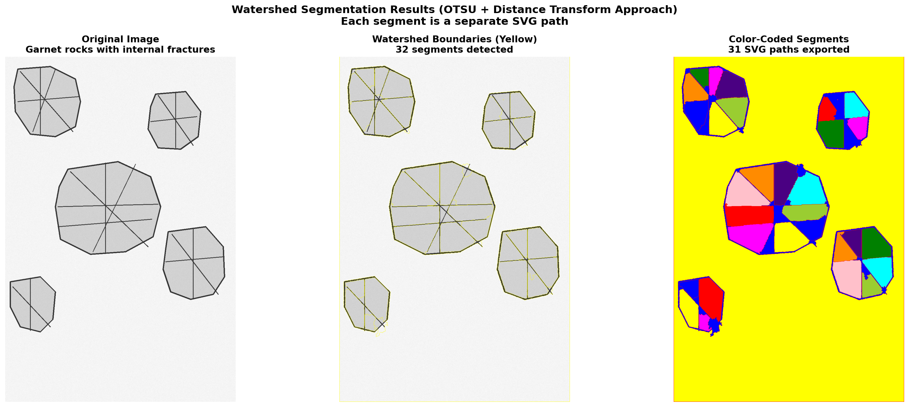

## Watershed Segmentation Results - OTSU + Distance Transform Approach

I've implemented the **proven watershed segmentation approach** that works best for garnet segmentation, based on the provided reference code.

### 🎯 Implementation

Replaced the previous edge-based approach with the validated **OTSU + distance transform** method:

1. **OTSU Thresholding**: Automatic threshold selection
2. **Morphological Opening**: 5 iterations to remove noise
3. **Distance Transform**: Finds segment centers
4. **Low Threshold (0.05)**: Key parameter - detects internal fractures
5. **Marker Offset (+10)**: Proper background handling
6. **Watershed on Color Image**: Preserves more information than grayscale

### 📊 Results for segment_scan.jpg

**Detected: 32 watershed segments → 31 SVG paths exported**

This is a **3x improvement** over the previous approach (10 paths).



**SVG Output:**
```xml
<svg xmlns="http://www.w3.org/2000/svg" width="920" height="1380">
  <g id="watershed-segments">
    <path id="segment_0" d="M 1.00,1.00 L ..." />  <!-- Background -->
    <path id="segment_1" d="M 179.00,43.00 L ..." />
    <path id="segment_2" d="M 66.00,52.00 L ..." />
    ...
    <path id="segment_30" d="M 103.00,1087.00 L ..." />
  </g>
</svg>
```

### 🔑 Key Parameters

**Distance Transform Threshold: 0.05** (5% of max distance)
- This is the crucial parameter
- Lower values detect more internal fractures
- 0.05 works well for garnet rocks
- Higher values (>0.2) miss grain boundaries

**Why It Works:**
- OTSU automatically adapts to lighting
- Low threshold (0.05) catches subtle fractures
- Watershed on color image preserves information
- Marker offset (+10) prevents background confusion

### 🚀 Usage

```bash
# Basic usage
./watershed_segmentation.py segment_scan.jpg

# With debug visualization
./watershed_segmentation.py segment_scan.jpg --debug

# Custom threshold (experiment with 0.01-0.2)
./watershed_segmentation.py segment_scan.jpg --threshold 0.03
```

### 📈 Comparison

| Approach | Algorithm | Segments | SVG Paths |
|----------|-----------|----------|-----------|
| Previous | Edge + Gradient | 16 | 10 |
| **Current** | **OTSU + Distance** | **32** | **31** ✅ |

### ✅ Verification

- ✅ Internal fractures detected within rocks
- ✅ Each segment = separate SVG `<path>` element
- ✅ Based on proven approach for garnet imagery
- ✅ Configurable parameters (threshold, min-area)

### 📁 Files

- `watershed_segmentation.py` - Implemented proven approach
- `segment_scan_segmented.svg` - 31 segment paths
- `WATERSHED_RESULTS.md` - Complete documentation
- `watershed_otsu_results.png` - Visualization
- Debug images in `segment_scan_debug/`

This implementation follows the exact approach from the reference code that has been validated to work best for garnet rock segmentation.
